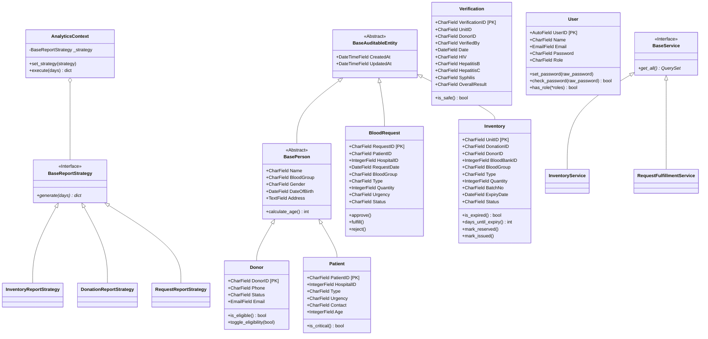
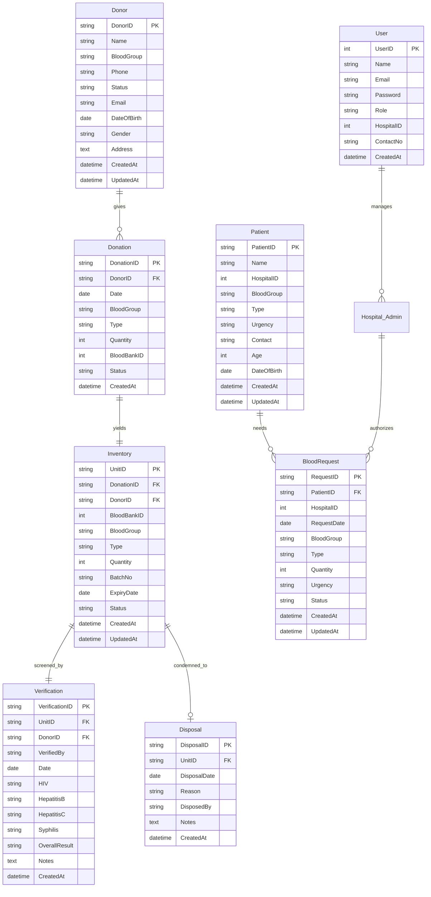
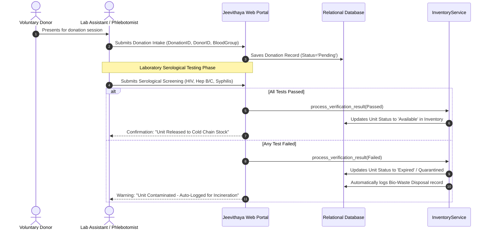
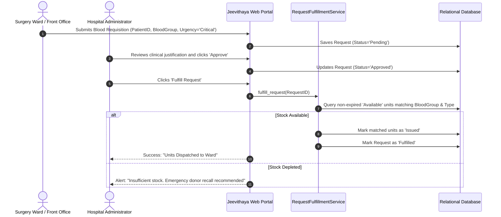

# Jeevithaya System Design & UML Architecture Diagrams
**Course:** Master of Information Technology (MIT)  
**Project:** Centralized Blood & Plasma Management System  
**Team:** Group 5 (MIT 2025/2026 Batch)  

---

## 1. Object-Oriented Class Diagram (UML)

This diagram illustrates the **OOP Inheritance Hierarchy**, **Abstract Classes**, and **Domain Services** across the application.

---

## 2. Entity-Relationship Diagram (ERD)

This diagram visualizes the **Physical Database Schema** and relational associations.

---

## 3. Clinical Workflow Sequence Diagram

### 3.1 Blood Intake, Testing, and Inventory Release
Traces how a physical blood bag moves through laboratory screening to available stock:

---

### 3.2 Transfusion Requisition & Smart Stock Deduction
Traces an emergency hospital request being matched and fulfilled from stock:

